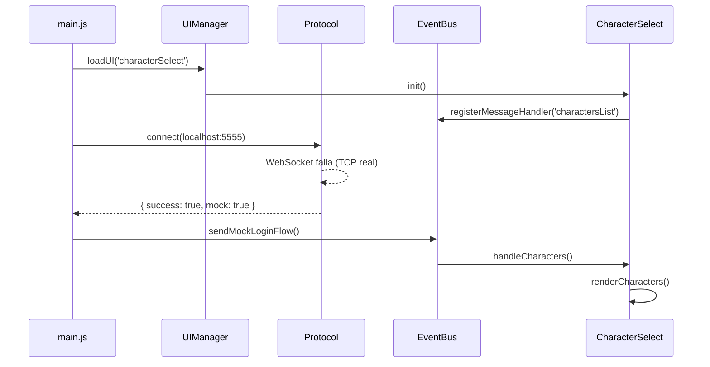

# DreamFus Client

> **Regla de Oro:** DreamFus Client es un proyecto fan-made que recrea mecánicas, apariencia, animaciones e interfaces del juego Dofus usando únicamente assets y formatos como placeholders temporales. Todo lo que puedas usar sin restricciones, sin dilemas. Estamos usando esos assets porque los quiero como placeholders para que más tarde yo use ese mismo estilo de animaciones, interfaces, etc. **TODO: música, sprites, sonidos.**

---

## 🌟 Propósito

Crear un cliente alternativo que:
- **Mecánicas:** Reimplemente el protocolo de Jondo desde cero
- **Apariencia:** Use el mismo estilo visual que el juego original
- **Animaciones:** Implemente sistemas de animación propios basados en el estilo de Dofus
- **Interfaz:** Siga la especificación DreamFus UI (documentada en `dreamfus-ui/`)

---

## 📁 Estructura del Proyecto

```
dreamfus-client/
├── package.json           # Configuración del proyecto Node.js/Vite
├── vite.config.js         # Configuración del build
├── README.md              # Este archivo
├── .gitignore             # Assets grandes, node_modules, etc.
│
└── frontend/              # Cliente web (Vite)
    ├── index.html         # Punto de entrada HTML
    ├── main.js            # Auto-conexión, flujo principal
    ├── EventBus.js        # Sistema centralizado de eventos
    ├── protocol.js        # WebSocket + Mock mode para testing
    ├── dfui/              # Motor DFUI (referencia a dreamfus-ui)
    │   ├── components.dfss # Estilos DFUI
    │   └── index.js       # Renderizador
    │
    └── ui/
        ├── UIManager.js    # Gestor de screens
        └── screens/
            ├── characterSelect.js
            ├── login.js
            └── mainMenu.js
```

---

## 🚀 Auto-Conexión (Funcionalidad Implementada)

### Flujo Automático



### Mock Characters (Testing)

```json
{
  "characters": [
    {
      "name": "Aldric",
      "class": "Sadida",
      "level": 15,
      "breed": 10
    },
    {
      "name": "Yuki", 
      "class": "Xelor",
      "level": 12,
      "breed": 5
    }
  ]
}
```

---

## 📊 Estado de Implementación

### ✅ Implementado (Functional)

| Componente | Archivo | Estado |
|------------|---------|--------|
| **Protocolo WebSocket** | `src/lib.rs` | ✅ Completado - Frame parsing con VarInt, envelope building |
| **Auto-conexión** | `frontend/src/main.js` | ✅ Completado - Mock mode con personajes de prueba |
| **EventBus centralizado** | `frontend/src/EventBus.js` | ✅ Completado - Sistema de eventos con subscribe/unsubscribe |
| **DFUI Renderer** | `frontend/src/dfui/index.js` | ✅ Completado - Componentes WindowFigma, DofusLabel, etc. |
| **Character Select Screen** | `frontend/src/ui/screens/characterSelect.js` | ✅ Completado - Manejo de lista de personajes |
| **UI Manager** | `frontend/src/ui/UIManager.js` | ✅ Completado - Carga de screens y manejo de mensajes |
| **Server Messages** | `frontend/src/main.js` (mocks) | ✅ Completado - Mensaje welcome, charactersList |

### 🚧 En Desarrollo / Pendiente

| Componente | Archivo/Sujeto | Estado | Notas |
|------------|----------------|--------|-------|
| **Tauri Backend Integration** | `src/lib.rs` | 🚧 Parcial | Necesita WebSocket en lugar de TCP directo |
| **Asset Catalog** | `src/lib.rs` | ❌ No implementado | Para cargar assets de Alea |
| **Login Screen** | `frontend/src/ui/screens/login.js` | 🚧 Fallback | Solo como pantalla de respaldo |
| **Main Menu** | `frontend/src/ui/screens/mainMenu.js` | ❌ No conectado | Necesita handlers reales |
| **Friends Screen** | `frontend/src/ui/screens/friends.js` | ❌ Básico | Mock mode solo |
| **DFUI Components** | `frontend/src/dfui/components/` | ❌ Parcial | Solo definición estática |
| **WebSocket 4-byte framing** | `src/lib.rs` | ❌ Pendiente | Para puerto 5557 (auth) vs 5555 (juego) |

### 🧪 Arquitectura Tauri/Vite Actual

```
DofusClient/
├── src/                    # Rust backend (TCP bridge)
│   └── lib.rs             # Servidor de conexión TCP
├── src-tauri/             # Tauri configuration
│   └── main.rs            # Punto de entrada Tauri
├── frontend/              # Vite frontend
│   ├── main.js           # ✅ Auto-conexión y mock flow
│   ├── protocol.js       # ✅ WebSocket + Mock mode
│   ├── EventBus.js       # ✅ Sistema de eventos
│   ├── dfui/             # ✅ Motor DFUI parcial
│   │   └── index.js
│   └── ui/
│       ├── UIManager.js   # ✅ Gestor de screens
│       └── screens/      # 🚧 Pantallas principales
│           ├── characterSelect.js  # ✅ Conectado
│           ├── login.js             # ⚠️ Fallback
│           ├── mainMenu.js          # ⚠️ Mock
│           └── friends.js           # ⚠️ Mock
├── public/ui/            # DFUI templates
│   ├── characterSelect.dfui
│   └── friends.dfui
├── tauri.conf.json
└── package.json
```

### 🔧 Flujo Actual (Mock Mode)

```
main.js
  ├─> UIManager.loadUI('characterSelect')
  ├─> Protocol.connect() → Mock (WebSocket TCP falla)
  ├─> Protocol.sendMockLoginFlow()
  └─> EventBus emite 'charactersList' → CharacterSelect.render()
```

### 📋 Próximos Pasos

1. **WebSocket Authentication** - Implementar en `src/lib.rs` para puerto 5557
2. **Asset Catalog** - Sistema de resolución de paths Alea
3. **Real Connection Flow** - Integración con Tauri invoke para producción
4. **UI Screen Handlers** - Conectar login y mainMenu con handlers reales

## ⚠️ Notas de Assets

Los assets de Alea se usan como **placeholders**:

| Tipo | Ubicación Temporal | Nota |
|------|-------------------|------|
| uitk/uxml/*.json | `assets/uitk/uxml/` | Screens JSON |
| uitk/uss/*.css | `assets/uitk/uss/` | Estilos CSS |
| uitk/img/ | `assets/uitk/img/` | Sprites UI |
| uitk/fonts/ | `assets/uitk/fonts/` | Fuentes |

**Estos assets no se distribuyen por defecto en el repositorio.** El usuario
debe configurar una instalación autorizada mediante una configuración local
basada en [`dreamfus.runtime.example.json`](dreamfus.runtime.example.json):
```
C:\ruta\de\la\instalacion\
```

---

## 🔄 Futuro

1. Implementar el `AssetCatalog` Tauri/Rust.
2. Migrar pantallas y proveedores por categorías.
3. Mantener fixtures para colaboradores sin Alea.
4. Añadir el launcher con rutas explícitas y servidor de pruebas aislado.
5. Publicar solo recursos cuya redistribución esté documentada.