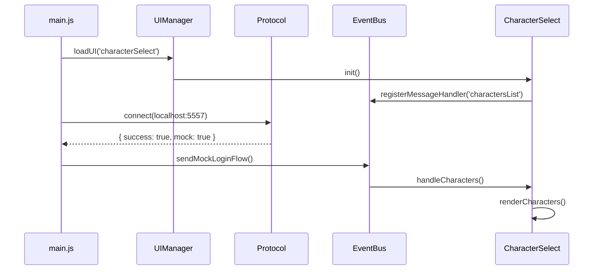

# DreamFus Client

> **Cliente alternativo de Dofus con cliente Godot 4.8 (GDScript puro)**
>
> **Proyecto:** https://github.com/Pevalcar/dreamfus-client.git
> **Ruta local:** `C:\Users\pevalcar\Proyectos\jondo-servidor\DofusClient`

> **Golden Rule:** DreamFus Client is a fan-made project that reimplements Dofus mechanics, visuals, animations, and interfaces from scratch using freely usable assets and temporary placeholders.

---

## 🎯 Purpose

Create an alternative client that:
- **Mechanics:** Reimplements the Jondo protocol from scratch
- **Visuals:** Uses the same visual style as the original game
- **Animations:** Implements custom animation systems in Dofus style
- **Interface:** Follows the DreamFus UI specification (documented in `dreamfus-ui/`)

**Main References:**
- **ALDA** (`C:\Users\pevalcar\AppData\Local\Alea\`) — Reference Tauri/WebGL2 client (DO NOT extract/distribute)
- **DreamFusion Client** (`C:\Users\pevalcar\AppData\Local\DreamFus\Cliente\`) — Extractable assets source

---

## 📋 Architecture

### Current Structure (Godot 4.8 - GDScript only)

```
DofusClient/
├── godot-client/              # Main Godot 4.8 project (GDScript)
│   ├── project.godot          # Godot project file
│   ├── scenes/                # Scene files
│   │   ├── Main.tscn          # Entry point
│   │   ├── Launcher.tscn      # Login screen
│   │   ├── CharacterSelect.tscn  # Character selection
│   │   └── Game.tscn          # In-game scene
│   ├── src/                   # Scripts
│   │   ├── A2D/               # Avatar rendering (A2D.Z parser)
│   │   ├── Core/              # Game logic
│   │   ├── Network/           # WebSocket & TCP protocol
│   │   ├── Data/              # Data models
│   │   └── UI/                # User interface
│   └── docs/                  # Client-specific docs
│
├── src/                       # Legacy Rust/Tauri reference (kept for documentation)
│   ├── lib.rs                 # Library exports (REFERENCE)
│   └── a2d/
│       └── mod.rs             # A2D parser (Rust reference)
│
├── docs/                      # Architecture documentation
│   ├── DEFLATE_SOLUTION.md  # Deflate handling in Godot
│   └── A2D_FLOW.md            # A2D parsing documentation
│
└── .gitignore                 # Exclusion rules
```

**⚠️ Note:** The Rust/Tauri backend (`src/lib.rs`, `src-tauri/`) is kept as **reference documentation only** and is not used by the active Godot client.

---

## 📁 Project Structure

| Phase | Objective | Status |
|-------|-----------|--------|
| **Phase 1** | Foundation & Build Setup | ✅ Complete |
| **Phase 2** | Protocol Implementation (WebSocket Auth + TCP Bridge) | ✅ Complete |
| **Phase 3** | UI Integration | ✅ Complete |

**See detailed roadmap:** `docs/IMPLEMENTATION-ROADMAP.md`

---

## 🚀 Current Status - Godot Client (GDScript)

### ✅ Complete Components

| Component | File | Status |
|-----------|------|--------|
| WebSocket Client | `src/Network/SimpleProtocolClient.gd` | ✅ Complete |
| TCP Game Client | `src/Network/GameClient.gd` | ✅ Complete |
| Protobuf Utilities | `src/Network/Proto.gd` | ✅ Complete |
| Game Manager | `src/Core/GameManager.gd` | ✅ Complete |
| Character Select UI | `src/UI/CharacterSelectUI.gd` | ✅ Complete |
| A2D Parser | `src/A2D/A2DParser.gd` | ✅ Basic (WebP extraction) |
| Byte Utilities | `src/A2D/Bytes.gd` | ✅ Complete |

### 📁 Project Structure

```
DofusClient/
├── package.json           # Node.js/Vite project config
├── vite.config.ts         # Build configuration
├── README.md              # This file
├── README_ES.md           # Spanish version
├── .gitignore             # Large assets, node_modules, etc.
│
├── src/                   # Rust backend (Tauri commands)
│   └── lib.rs             # WebSocket/TCP bridge
│
├── src-tauri/             # Tauri configuration
│   ├── main.rs            # Entry point
│   └── tauri.conf.json    # Config
│
├── frontend/              # Vite frontend (TypeScript)
│   ├── index.html         # HTML entry point
│   ├── main.js            # Auto-connect + main flow
│   ├── protocol.js        # WebSocket wrapper + Mock mode
│   ├── EventBus.js        # Centralized event system
│   ├── dfui/              # DFUI (DreamFus UI) engine
│   │   └── index.js       # Renderer
│   │
│   └── ui/
│       ├── UIManager.js   # Screen manager
│       └── screens/
│           ├── login.js
│           ├── characterSelect.js
│           ├── mainMenu.js
│           └── friends.js
│
├── public/
│   └── ui/                 # Static DFUI documents
│       └── *.dfui
├── docs/
│   ├── IMPLEMENTATION-ROADMAP.md
│   ├── SIMPLE-PROTOCOL-HOOKS.md
│   ├── CUSTOM-HOOKS.md
│   ├── CONTRIBUTING.md
│   ├── ASSET-STRATEGY.md
│   └── dreamfus-phases.md
└── Cargo.toml
```

---

## 🚀 Auto-Connect

### Automatic Flow



---

## 📊 Implementation Status

### ✅ Complete

| Component | Location | Status |
|-----------|----------|--------|
| **WebSocket/TCP Protocol (Frontend)** | `src/lib.rs` | ✅ Complete - VarInt, envelope building |
| **Auto-connect** | `frontend/src/main.js` | ✅ Complete - Mock mode |
| **Centralized EventBus** | `frontend/src/EventBus.js` | ✅ Complete |
| **DFUI Renderer** | `frontend/src/dfui/index.js` | ✅ Complete - Basic components |
| **Character Select Screen** | `frontend/src/ui/screens/characterSelect.js` | ✅ Complete - Mock mode |
| **UI Manager** | `frontend/src/ui/UIManager.js` | ✅ Complete |
| **Server Messages (mock)** | `frontend/src/main.js` | ✅ Complete |
| **Login Screen** | `frontend/src/ui/screens/login.js` | ✅ Complete - Functional fallback |
| **TCP Handshake (Godot Client)** | `godot-client/` | ✅ Complete - Full protobuf implementation |

### 🚧 In Progress / Pending

| Component | Location | Status | Notes |
|-----------|----------|--------|-------|
| **Tauri Backend Integration** | `src/lib.rs` | 🚧 Partial | Needs real WebSocket to 5557 |
| **WebSocket 4-byte framing** | `protocol.js` | 🚧 Partial | Port 5557 (auth) vs 5555 (game) |
| **Main Menu** | `frontend/src/ui/screens/mainMenu.js` | ⚠️ Mock | Needs real handlers |
| **Friends Screen** | `frontend/src/ui/screens/friends.js` | ⚠️ Mock | Mock mode only |
| **Godot Game World** | `godot-client/` | ⏳ Planned | World rendering, gameplay systems |

### godot-client/ - Godot 4.8 Client (Independent Piece)

**Status:** ✅ **Handshake Complete**

The pure GDScript Godot 4.8 client is fully functional for authentication and character selection:

| Component | File | Status |
|-----------|------|--------|
| WebSocket Client | `src/Network/SimpleProtocolClient.gd` | ✅ Complete |
| TCP Game Client | `src/Network/GameClient.gd` | ✅ Complete |
| Protobuf Utilities | `src/Network/Proto.gd` | ✅ Complete |
| Game Manager | `src/Core/GameManager.gd` | ✅ Complete |
| Character Select UI | `src/UI/CharacterSelectUI.gd` | ✅ Complete |
| Character Data Model | `src/Data/CharacterData.gd` | ✅ Complete |

**TCP Handshake Flow:**
1. WebSocket auth → server_selection → ticket
2. TCP connection to GameNodeProxy (5555)
3. Send `kqz` (ticket)
4. Receive welcome burst: `kra` → `kqp` → `lqu` → `hoy` → `kqu` → `mgq/mgt/hpd` → `krs` → `mgz` → `kqp` → `kvi` → `jtg`
5. Parse `kvi` and emit `characters_received`
6. Send `kvw` when character selected

See `godot-client/docs/TCP_HANDBSHAKE.md` and `godot-client/docs/PROTOCOL.md` for full documentation.

---

## 📚 Documentation

| Document | Purpose |
|----------|---------|
| `docs/IMPLEMENTATION-ROADMAP.md` | Complete implementation roadmap |
| `docs/SIMPLE-PROTOCOL-HOOKS.md` | SimpleProtocol API (WebSocket, port 5557) |
| `docs/CUSTOM-HOOKS.md` | Client hooks and event system registry |
| `docs/CONTRIBUTING.md` | How to contribute |
| `docs/ASSET-STRATEGY.md` | Asset extraction strategy |
| `docs/dreamfus-phases.md` | Official phases and roadmap |
| `docs/research/` | Technical protocol research |
| `godot-client/README.md` | Godot client specific documentation |
| `godot-client/docs/PROTOCOL.md` | TCP/Protobuf protocol documentation |
| `godot-client/docs/TCP_HANDBSHAKE.md` | Detailed TCP handshake implementation |

---

## 🔌 Protocol Implementation

### SimpleProtocol (Port 5557) - WebSocket JSON

**Documentation:** `docs/SIMPLE-PROTOCOL-HOOKS.md`

**Authentication Flow:**
1. Connect WebSocket to `ws://localhost:5557`
2. Send `auth_request` with token
3. Receive `auth_response` with server list
4. Send `server_selection` with server_id
5. Receive `server_selection_response` with ticket
6. Connect to port 5555 with ticket

### Game Protocol (Port 5555) - Protobuf

**Documentation:** `godot-client/docs/TCP_HANDBSHAKE.md`

Key messages:
- `kqz` - Present ticket (client → server)
- `kra` - Acknowledgment (server → client)
- `kvi` - Character list (server → client) 
- `kvw` - Select character (client → server)
- `jtg` - End of welcome burst trigger (server → client)
- `+` lqu, hoy, kqu, mgq, mgt, hpd, krs, mgz, kqp - Welcome burst messages

**Character Data Fields (from kvi):**
- `id` (int64) - Character ID
- `name` (string) - Character name  
- `level` (int32) - Character level
- `sex` (int32) - Character sex (inside traits/f4)
- `breed` (int32) - Character breed (inside traits/f4)
- `look` (bytes) - Character appearance data (inside traits/f4)

**Important:** In the kvi protobuf structure, `look` (f6) and `breed` (f7) are nested inside the traits block (f4), not at the character level. The Godot client's `Proto.decode_kvi()` correctly handles this nesting.

---

## 🎯 Test Account

Use these credentials for testing:

```
Username: keka
Password: test
Account ID: 188940901
Server ID: 290 (DreamFus)
```

---

## 💻 Development

### Godot MCP Toolkit (Recommended)

For enhanced code navigation and analysis, install the Godot MCP Toolkit:

```bash
# Install via npm (global)
npm install -g @npgamedev/godot-mcp-server@1.1.2

# Or use via npx (local to project)
npx @npgamedev/godot-mcp-server@1.1.2
```

**Features provided by MCP:**
- Symbol search and navigation
- Code tracing and relationships
- Architecture queries
- Coverage verification

### Run Godot

```bash
# Open project in Godot 4.8
"C:\Users\<tu-usuario>\Godot\Godot.exe" --path godot-client

# Run in headless mode (for CI/testing)
"C:\Users\<tu-usuario>\Godot\Godot.exe" --headless --path godot-client --quit
```

### Development Workflow

```bash
# 1. Open Godot project
godot --path godot-client

# 2. Configure Godot MCP (see CONTRIBUTING.md for details)

# 3. Test changes in Godot editor

# 4. Run headless verification
"C:\Users\<tu-usuario>\Godot\Godot.exe" --headless --path godot-client --quit
```

---

## 🤝 Contributing

1. Fork the repository
2. Create a feature branch
3. Install Godot MCP Toolkit: `npm install -g @npgamedev/godot-mcp-server@1.1.2`
4. Open project in Godot 4.8
5. Follow `docs/CONTRIBUTING.md`
6. Submit a pull request

**For Godot development:**
- Use GDScript only (no C#/Tauri/TypeScript)
- Reference Rust code in `src/a2d/mod.rs` for A2D parsing
- See `godot-client/README.md` for client-specific docs

---

## 🚫 Asset Policy

- **DO NOT** redistribute any ALDA or DreamFusion assets
- **DO NOT** commit extracted assets to this repository
- Extracted assets are for local development only

See `docs/ASSET-STRATEGY.md` for extraction guidelines.

---

## 📖 Additional Resources

- `docs/` - Full documentation
- `dreamfus-ui/` - UI specification
- `docs/research/` - Protocol research

---

*Last updated: November 2026*
*Version: 1.0*