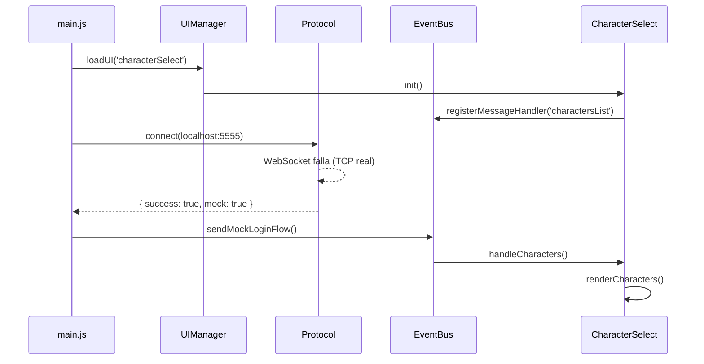

# DreamFus Client

> **Regla de Oro:** DreamFus Client es un proyecto fan-made que recrea mecánicas, apariencia, animaciones e interfaces del juego Dofus usando únicamente assets y formatos como placeholders temporales. Todo lo que puedas usar sin restricciones, sin dilemas. Estamos usando esos assets porque los quiero como placeholders para que más tarde yo use ese mismo estilo de animaciones, interfaces, etc. **TODO: música, sprites, sonidos.**

---

## 🌟 Propósito

Crear un cliente alternativo que:
- **Mecánicas:** Reimplemente el protocolo de Jondo desde cero
- **Apariencia:** Use el mismo estilo visual que el juego original
- **Animaciones:** Implemente sistemas de animación propios basados en el estilo de Dofus
- **Interfaz:** Siga la especificación DreamFus UI (documentada en `dreamfus-ui/`)

---

## 📁 Estructura del Proyecto

```
dreamfus-client/
├── package.json           # Configuración del proyecto Node.js/Vite
├── vite.config.js         # Configuración del build
├── README.md              # Este archivo
├── .gitignore             # Assets grandes, node_modules, etc.
│
└── frontend/              # Cliente web (Vite)
    ├── index.html         # Punto de entrada HTML
    ├── main.js            # Auto-conexión, flujo principal
    ├── EventBus.js        # Sistema centralizado de eventos
    ├── protocol.js        # WebSocket + Mock mode para testing
    ├── dfui/              # Motor DFUI (referencia a dreamfus-ui)
    │   ├── components.dfss # Estilos DFUI
    │   └── index.js       # Renderizador
    │
    └── ui/
        ├── UIManager.js    # Gestor de screens
        └── screens/
            ├── characterSelect.js
            ├── login.js
            └── mainMenu.js
```

---

## 🚀 Auto-Conexión (Funcionalidad Implementada)

### Flujo Automático



### Mock Characters (Testing)

```json
{
  "characters": [
    {
      "name": "Aldric",
      "class": "Sadida",
      "level": 15,
      "breed": 10
    },
    {
      "name": "Yuki", 
      "class": "Xelor",
      "level": 12,
      "breed": 5
    }
  ]
}
```

---

## 🎨 Desarrollo

### Setup Local

```bash
# 1. Tener Alea instalado (para assets reales)
# 2. Ir al cliente
cd dreamfus-client/frontend
npm install
npm run dev
```

### Auto-Conexión Demo

```bash
# Ver en: http://localhost:1420
# Sin login screen - va directo a characterSelect
# Usa assets de Alea (placeholder temporal)
```

---

## 📚 Referencias

- **DreamFus UI Specification:** `dreamfus-ui/docs/` (submodule)
- **Protocolo Jondo:** `docs/unknown-packets.md`
- **UI CLIENTE:** `docs/UI-CLIENTE.md`
- **Investigación y diseño del cliente:** [`docs/research/INDEX.md`](docs/research/INDEX.md)

La carpeta `docs/research/` conserva la arquitectura propuesta, el diseño de
combate, movimiento, chat, inventario, mundo, personajes, mapas y entidades,
además de referencias públicas y sus restricciones de licencia. Es la guía
para continuar el cliente sin depender de una conversación anterior.

---

## ⚠️ Notas de Assets

Los assets de Alea se usan como **placeholders**:

| Tipo | Ubicación Temporal | Nota |
|------|-------------------|------|
| uitk/uxml/*.json | `assets/uitk/uxml/` | Screens JSON |
| uitk/uss/*.css | `assets/uitk/uss/` | Estilos CSS |
| uitk/img/ | `assets/uitk/img/` | Sprites UI |
| uitk/fonts/ | `assets/uitk/fonts/` | Fuentes |

**Estos assets NO se distribuyen en el repositorio.** El usuario debe obtenerlos de su instalación de Alea:
```
C:\Users\USER\AppData\Local\Alea\app-\version\assets\
```

---

## 🔄 Futuro

1. **Implementar client Tauri/Rust** como Alea
2. **Crear assets propios** con el mismo estilo
3. **Sin dependencias de Alea** - completamente independiente
4. **Distribución como .exe** usando el mismo pipeline de Alea