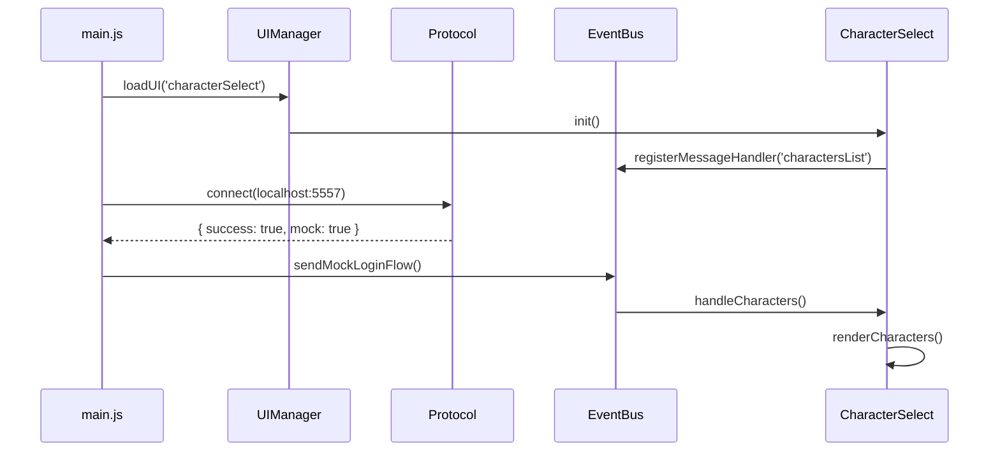

# DreamFus Client

> **Regla de Oro:** DreamFus Client es un proyecto fan-made que recrea mecánicas, apariencia, animaciones e interfaces del juego Dofus desde cero usando únicamente assets y formatos libres y placeholders temporales.

---

## 🎯 Propósito

Crear un cliente alternativo que:
- **Mecánicas:** Reimplemente el protocolo Jondo desde cero
- **Apariencia:** Use el mismo estilo visual que el juego original
- **Animaciones:** Implemente sistemas de animación propios basados en estilo Dofus
- **Interfaz:** Siga la especificación DreamFus UI (documentada en `dreamfus-ui/`)

**Referencias principales:**
- **ALDA** (`C:\Users\pevalcar\AppData\Local\Alea\`) — Cliente Tauri/WebGL2 de referencia (NO extraer/distribuir)
- **DreamFusion Client** (`C:\Users\pevalcar\AppData\Local\DreamFus\Cliente\`) — Fuente de assets extraíbles

---

## 📋 Roadmap de Implementación

| Fase | Objetivo | Estado |
|------|----------|--------|
| **Fase 1** | Foundation & Build Setup | ✅ Completada |
| **Fase 2** | Protocol Implementation (WebSocket Auth + TCP Bridge) | 🚧 En Desarrollo |
| **Fase 3** | UI Integration | 🚧 En Desarrollo |

**Ver detalles completos:** `docs/IMPLEMENTATION-ROADMAP.md`
**Ver fases oficiales:** `docs/dreamfus-phases.md`

---

## 📁 Estructura del Proyecto

```
DofusClient/
├── package.json           # Configuración Node.js/Vite
├── vite.config.ts         # Configuración del build
├── README.md              # Archivo principal (inglés)
├── README_ES.md           # Esta versión (español)
├── .gitignore             # Assets grandes, node_modules, etc.
│
├── src/                   # Rust backend (Tauri commands)
│   └── lib.rs             # WebSocket/TCP bridge
│
├── src-tauri/             # Configuración Tauri
│   ├── main.rs            # Punto de entrada
│   └── tauri.conf.json    # Config
│
├── frontend/              # Vite frontend (TypeScript)
│   ├── index.html         # Punto de entrada HTML
│   ├── main.js            # Auto-conexión + flujo principal
│   ├── protocol.js        # WebSocket wrapper + Mock mode
│   ├── EventBus.js        # Sistema centralizado de eventos
│   ├── dfui/              # Motor DFUI (DreamFus UI)
│   │   └── index.js       # Renderer
│   │
│   └── ui/
│       ├── UIManager.js   # Gestor de screens
│       └── screens/
│           ├── login.js
│           ├── characterSelect.js
│           ├── mainMenu.js
│           └── friends.js
│
├── public/
│   └── ui/                 # Documentos DFUI estáticos
│       └── *.dfui
├── docs/
│   ├── IMPLEMENTATION-ROADMAP.md
│   ├── SIMPLE-PROTOCOL-HOOKS.md
│   ├── CUSTOM-HOOKS.md
│   ├── CONTRIBUTING.md
│   ├── ASSET-STRATEGY.md
│   └── dreamfus-phases.md
└── Cargo.toml
```

---

## 🚀 Auto-Conexión

### Flujo Automático



---

## 📊 Estado de Implementación

### ✅ Completado

| Componente | Archivo | Estado |
|------------|---------|--------|
| **Protocolo WebSocket/TCP** | `src/lib.rs` | ✅ Completado - VarInt, envelope building |
| **Auto-conexión** | `frontend/src/main.js` | ✅ Completado - Mock mode |
| **EventBus centralizado** | `frontend/src/EventBus.js` | ✅ Completado |
| **DFUI Renderer** | `frontend/src/dfui/index.js` | ✅ Completado - Componentes básicos |
| **Character Select Screen** | `frontend/src/ui/screens/characterSelect.js` | ✅ Completado - Mock mode |
| **UI Manager** | `frontend/src/ui/UIManager.js` | ✅ Completado |
| **Server Messages (mock)** | `frontend/src/main.js` | ✅ Completado |
| **Login Screen** | `frontend/src/ui/screens/login.js` | ✅ Completado - Fallback funcional |

### 🚧 En Desarrollo / Pendiente

| Componente | Archivo | Estado | Notas |
|------------|---------|--------|-------|
| **Tauri Backend Integration** | `src/lib.rs` | 🚧 Parcial | Necesita WebSocket real a 5557 |
| **WebSocket 4-byte framing** | `protocol.js` | 🚧 Parcial | Puerto 5557 (auth) vs 5555 (juego) |
| **Main Menu** | `frontend/src/ui/screens/mainMenu.js` | ⚠️ Mock | Necesita handlers reales |
| **Friends Screen** | `frontend/src/ui/screens/friends.js` | ⚠️ Mock | Solo modo mock |

---

## 📚 Documentación

| Documento | Propósito |
|-----------|-----------|
| `docs/IMPLEMENTATION-ROADMAP.md` | Roadmap completo de implementación |
| `docs/SIMPLE-PROTOCOL-HOOKS.md` | API de SimpleProtocol (WebSocket, puerto 5557) |
| `docs/CUSTOM-HOOKS.md` | Registro de hooks y sistema de eventos del cliente |
| `docs/CONTRIBUTING.md` | Cómo contribuir |
| `docs/ASSET-STRATEGY.md` | Estrategia de extracción de assets |
| `docs/dreamfus-phases.md` | Fases oficiales y roadmap |
| `docs/research/` | Investigación técnica del protocolo |

---

## 🔌 Protocol Implementation

### SimpleProtocol (Puerto 5557) - WebSocket JSON

**Documentación:** `docs/SIMPLE-PROTOCOL-HOOKS.md`

**Flujo de autenticación:**
1. Conectar WebSocket a `ws://localhost:5557`
2. Enviar `auth_request` con token
3. Recibir `auth_response` con lista de servidores
4. Enviar `server_selection` con server_id
5. Recibir `server_selection_response` con ticket
6. Conectar a puerto 5555 con ticket

### Game Protocol (Puerto 5555) - Protobuf

Mensajes clave:
- `krt` - Hello (conexión inicial)
- `kuf` - Server hello (respuesta)
- `kvi` - Character list
- `kvw` - Select character
- `kqz` - Present ticket
- `hpd` - Position

---

## 🎯 Cuenta de Prueba

Usar estas credenciales para pruebas:

```
Usuario: keka
Contraseña: test
Account ID: 188940901
Server ID: 290 (DreamFus)
```

---

## 💻 Desarrollo

### Instalar Dependencias

```bash
cd frontend
npm install
```

### Desarrollo

```bash
# Frontend
cd frontend && npm run dev

# Build
cd frontend && npm run build

# Tauri (Rust backend)
cd .. && cargo build
```

### Ejecutar Tests

```bash
cargo test
```

---

## 🤝 Contribuyendo

1. Fork del repositorio
2. Crear una rama de feature
3. Seguir `docs/CONTRIBUTING.md`
4. Enviar pull request

**Nota:** Este proyecto es fan-made. No se redistribuyen assets del juego. Usar placeholders o extraer assets localmente para desarrollo únicamente.

---

## 🚫 Política de Assets

- **NO** redistribuir assets de ALDA o DreamFusion
- **NO** commitear assets extraídos al repositorio
- Los assets extraídos son solo para desarrollo local

Ver `docs/ASSET-STRATEGY.md` para guías de extracción.

---

## 📖 Recursos Adicionales

- `docs/` - Documentación completa
- `dreamfus-ui/` - Especificación de UI
- `docs/research/` - Investigación del protocolo

---

*Última actualización: Noviembre 2026*
*Versión: 1.0*