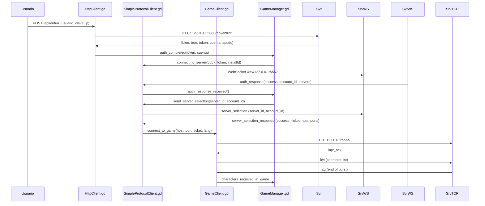

# Plan Técnico SDD — Spec 001 (Flujo de Login)

**Estado:** ✅ **APROBADO para generación de tareas**

---

## 1. Arquitectura de Módulos

### 1.1 Diagrama de Arquitectura (Layered)

```
┌─────────────────────────────────────────────────────────────────────┐
│  PRESENTATION LAYER (UI)                                              │
│  ├─ Main.gd (Controlador principal)                                  │
│  └─ AuthUI.gd (Formulario de login + selección de servidor)       │
├─────────────────────────────────────────────────────────────────────┤
│  APPLICATION LAYER (Orquestación)                                   │
│  ├─ GameManager.gd (Singleton - orquestador de estados del juego)   │
│  └─ AuthManager.gd (Manejo de errores, estados de conexión)        │
├─────────────────────────────────────────────────────────────────────┤
│  PRESENTATION LAYER (Network Protocols)                             │
│  ├─ HttpClient.gd (HTTP client para /api/entrar)                     │
│  ├─ SimpleProtocolClient.gd (WebSocket client port 5557)           │
│  └─ GameClient.gd (TCP client protobuf port 5555 + kqz framing)     │
├─────────────────────────────────────────────────────────────────────┤
│  INFRASTRUCTURE LAYER (Utilities)                                   │
│  ├─ Proto.gd (Serialización protobuf/varint)                         │
│  ├─ WorldProto.gd (Decodificadores mensajes mundo)                 │
│  └─ ByteArrayExtensions.gd (Helpers de manipulación bytes)        │
└─────────────────────────────────────────────────────────────────────┘
```

### 1.2 Responsabilidades por Módulo

| Módulo | Responsabilidad | RF Asociados |
|--------|----------------|--------------|
| `HttpClient.gd` | Cliente HTTP para login | RF-1, RF-2, RF-10 |
| `SimpleProtocolClient.gd` | WebSocket para auth & server selection | RF-3, RF-4, RF-5, RF-9 |
| `GameClient.gd` | TCP para kqz & welcome burst | RF-6, RF-6.1, RF-6.2, RF-6.3, RF-7, RF-8 |
| `GameManager.gd` | Orquestación de estados | RF-1, RF-4, RF-5, RF-7 |
| `AuthManager.gd` | Manejo de errores y rate limiting | RF-7, RNF-9 |

---

## 2. File Impact Map

### 2.1 Archivos a CREAR (Nuevos módulos)

| Archivo | Propósito | RF(s) |
|---------|-----------|-------|
| `godot-client/src/Core/HttpClient.gd` | Cliente HTTP login (puerto 8888) | RF-1, RF-2, RF-10 |
| `godot-client/src/Data/AuthError.gd` | Estructura de errores auth (RFC para RF-9) | RF-9 |
| `godot-client/src/Core/AuthManager.gd` | Manejo de errores y estados de autenticación | RF-7, RNF-7, RNF-9 |
| `godot-client/test/HttpClientTest.gd` | Tests unitarios HTTP client | RF-1, RF-2, RF-10 |
| `godot-client/test/AuthErrorTest.gd` | Tests estructura AuthError | RF-9 |
| `godot-client/test/WebSocketClientTest.gd` | Tests unitarios WebSocket client | RF-3, RF-4 |
| `godot-client/test/TcpKqzTest.gd` | Tests unitarios kqz/TCP | RF-6, RF-6.1, RF-6.2, RF-6.3 |
| `godot-client/test/WalkingSkeletonTest.gd` | Test E2E del flujo completo | RF-1, RF-2, RF-5, RF-6, RF-7 |
| `godot-client/test/ErrorHandlingTest.gd` | Tests manejo de errores | RF-7 |

### 2.2 Archivos a MODIFICAR (Existentes)

| Archivo | Cambio | RF(s) |
|---------|--------|-------|
| `godot-client/src/Network/SimpleProtocolClient.gd` | Validación token, estados, timeout | RF-4, RF-5, RF-9 |
| `godot-client/src/Network/GameClient.gd` | send_ticket() con GameMessage directo | RF-6.1, RF-6.2, RF-6.3 |
| `godot-client/src/Network/Proto.gd` | Helpers para kqz framing | RF-6 |
| `godot-client/src/Core/GameManager.gd` | Integración con AuthManager, timeout handlers | RF-7 |

### 2.3 Archivos a LEER/REFERENCIAR

| Archivo | Uso |
|---------|-----|
| `godot-client/src/Network/WorldProto.gd` | Decodificación kvi/jtg |
| `godot-client/src/Utils/ByteArrayExtensions.gd` | Manipulación buffer |
| `docs/SIMPLE-PROTOCOL-HOOKS.md` | WebSocket JSON protocol |
| `godot-client/docs/PROTOCOL.md` | TCP/Protobuf format |

---

## 3. Modelo de Datos

### 3.1 AuthResult (Resultado HTTP Login)

```gdscript
class AuthResult:
    var bien: bool = false
    var token: String = ""
    var apodo: String = ""
    var cuenta: int = 0
    var motivo: String = ""  # Enum: "CREDENCIALES_INVALIDAS", "CUENTA_BLOQUEADA", etc.
```

### 3.2 ServerInfo (Lista de servidores)

```gdscript
class ServerInfo:
    var id: int = 0
    var name: String = ""
    var population: int = 0
    var is_full: bool = false
```

### 3.3 TicketInfo (Respuesta server_selection)

```gdscript
class TicketInfo:
    var success: bool = false
    var ticket: String = ""      # 32 chars hex lowercase
    var host: String = ""        # IP del servidor
    var ports: Array = []        # [5555, 5557]
    var error: String = ""       # Enum: "SERVIDOR_NO_EXISTE", "SERVIDOR_LLENO", "CUENTA_NO_AUTORIZADA"
```

### 3.4 GameState (Estados del cliente)

```gdscript
enum GameState {
    LAUNCHER,
    HTTP_SENT,
    WS_CONNECTED,
    AUTH_SENT,
    SERVER_SELECTION_SENT,
    TCP_TICKET_READY,
    IN_GAME,
    DISCONNECTED,
    ERROR
}
```

### 3.5 KqzMessage (Formato TCP)

```gdscript
class KqzMessage:
    var f1: PackedByteArray  # GameMessage interior
    # f1 contiene: { f2: ticket (32 hex chars), f3: language }
```

---

## 4. ADRs (Architecture Decision Records)

### ADR-001: Stack Técnico Godot 4.8 + GDScript Puro

**Decisión:** Usar Godot 4.8 beta2 con GDScript puro sin dependencias externas.

**Razón:** Cumple con P-001 (Stack Estricto). Evita complejidad de build systems.

**Consecuencia:** Menor rendimiento que C++, pero desarrollo más rápido para prototipo.

---

### ADR-002: GameMessage Directo para kqz (Sin Wrapper Any)

**Decisión:** Enviar ticket kqz como `GameMessage` directo sin wrapper `google.protobuf.Any`.

**Razón:** RF-6 establece que el servidor GameNode espera el opcode `kqz` directamente en el primer campo del GameMessage. El error `UNHANDLED CLIENT PACKET DETECTED: type.ankama.com/kqz` se resuelve con este enfoque.

**Formato:**
```
Packet {
  varint_length,
  GameMessage {
    f1: {  // kqz inner message
      f2: ticket (string),
      f3: language (string)
    }
  }
}
```

**Consecuencia:** Requiere construcción manual del mensaje sin helpers automáticos de Any.

---

### ADR-003: WebSocket JSON Protocol vs Protobuf

**Decisión:** Usar JSON para WebSocket (puerto 5557) y Protobuf para TCP (puerto 5555).

**Razón:** El protocolo WebSocket usa `SIMPLE-PROTOCOL-HOOKS.md` que define mensajes JSON. TCP usa Protobuf según `docs/PROTOCOL.md`.

**Consecuencia:** Dos deserializadores diferentes, pero cada uno simple para su contexto.

---

### ADR-004: Singleton GameManager para Orquestación

**Decisión:** Usar autoload `GameManager.instance` como singleton de orquestación.

**Razón:** Patrón establecido en el proyecto. Permite acceso global desde network callbacks.

**Consecuencia:** Estado compartido global, pero simplifica el binding con UI.

---

### ADR-005: Timeout 2s para WebSocket, 5s para TCP

**Decisión:** Implementar timeouts según RNF-7 y RNF-8.

**Razón:** RNF-7 establece 2s para WebSocket auth, RNF-8 establece 5s para TCP conexión.

**Consecuencia:** Necesario timer system y manejo de timeout para feedback de usuario.

---

## 5. Matriz de Cobertura RF → Módulos → Pruebas

| RF | Descripción | Módulo(s) | Prueba(s) |
|----|-------------|-----------|-----------|
| **RF-1** | Login HTTP exitoso | `HttpClient.gd` | Unit: `HttpClientTest.gd`<br>E2E: `WalkingSkeletonTest.gd` |
| **RF-2** | Login HTTP fallido (credenciales incorrectas) | `HttpClient.gd` | Unit: `HttpClientTest.gd` |
| **RF-3** | Conexión WebSocket aceptada | `SimpleProtocolClient.gd` | Integration: `WebSocketClientTest.gd` |
| **RF-4** | Auth Request Format | `SimpleProtocolClient.gd` | Unit: `WebSocketClientTest.gd` |
| **RF-5** | Server Selection Response Format | `SimpleProtocolClient.gd`, `GameClient.gd` | Integration: `TcpKqzTest.gd` |
| **RF-6** | Ticket kqz TCP Format | `GameClient.gd` | Integration: `TcpKqzTest.gd` |
| **RF-6.1** | Formato del ticket (f1, f2, f3) | `GameClient.gd` | Unit: `TcpKqzTest.gd` |
| **RF-6.2** | Validación regex `^[0-9a-f]{32}$` | `GameClient.gd` | Unit: `TcpKqzTest.gd` |
| **RF-6.3** | Envío inmediato del ticket | `GameClient.gd` | E2E: `test_kqz_burst_e2e.gd` |
| **RF-7** | Mensaje de error cuando el servidor está caído | `AuthManager.gd`, `SimpleProtocolClient.gd` | Unit: `ErrorHandlingTest.gd` |
| **RF-8** | Welcome Burst processing | `GameClient.gd` | E2E: `test_kqz_burst_e2e.gd` |
| **RF-9** | Rechazo de conexión inválida | `SimpleProtocolClient.gd`, `AuthError.gd` | Unit: `AuthErrorTest.gd` + Integration: `WebSocketClientTest.gd` |
| **RF-10** | Validación de credenciales de entrada | `HttpClient.gd` | Unit: `HttpClientTest.gd` |

| RNF | Descripción | Verificación |
|-----|-------------|--------------|
| **RNF-1** | Flujo completo < 5s | Test de timing en `WalkingSkeletonTest.gd` |
| **RNF-2** | JSON UTF-8 | Verificado en protocol spec |
| **RNF-3** | No credentials en logs | Manual review + grep |
| **RNF-4** | Validación ticket regex | Unit test `TcpKqzTest.gd` |
| **RNF-5** | Heartbeat kqo/kqy 5s | Implementado en `GameClient.gd` |
| **RNF-6** | Ticket envío < 100ms | Test timing en `TcpKqzTest.gd` |
| **RNF-7** | Timeout WebSocket 2s | `AuthManager.gd` |
| **RNF-8** | Timeout TCP 5s | `GameClient.gd` |
| **RNF-9** | Rate limiting 10/60s | `AuthManager.gd` (backend) |

---

## 6. Diagramas de Secuencia (RF-1 → RF-8)

### 6.1 Flujo de Login Completo



---

## 7. Checkpoints y Verificaciones

### 7.1 Verificación de P-001 (Stack Estricto)
```bash
grep -E "(dependencies|devDependencies)" package.json | grep -v "godot\|mcp\|codebase-memory" && echo "APPROVAL REQUIRED"
# Resultado esperado: ningún match (solo Godot)
```

### 7.2 Verificación de P-002 (Testing GUT)
```bash
godot --headless --path godot-client --run-gut-tests
# Coverage report: lines >= 80%
```

### 7.3 Verificación de P-003 (Límites Arquitectónicos)
```bash
find godot-client/src -name "*.gd" -exec wc -l {} \; | awk '$1 > 500 {print "VIOLATION:", $0}'
# Resultado esperado: ningún match
```

### 7.4 Verificación de P-004 (Calidad de Código)
```bash
gdlint godot-client/src/ --exit-with-zero-on-warning
# Resultado esperado: 0 warnings
```

### 7.5 Verificación de P-005 (Seguridad)
```bash
grep -rnE "(password|token|secret|credential)" --include="*.gd" godot-client/src/
# Resultado esperado: 0 matches (excepto parámetros de función)
```

### 7.6 Verificación de P-006 (Convenciones)
- [x] Comentarios en español
- [x] Naming: PascalCase clases, camelCase métodos/vars
- [x] Conventional Commits respetados

---

## 8. Riesgos y Mitigaciones

| Riesgo | Probabilidad | Impacto | Mitigación |
|--------|--------------|---------|------------|
| Servidor no disponible | Media | Alto | Manejo de timeout con popup |
| Ticket expirado/usado | Baja | Alto | Validación local regex, reintentos |
| Conexiones simultáneas | Media | Medio | Single-session enforcement |
| Rate limiting 429 | Baja | Medio | Backoff exponencial en cliente |

---

## 9. Historias Pendientes (H2, H3)

> **Nota:** H2 ( selección de personajes) y H3 (entrar al mapa) están fuera del alcance de Spec 001. Se implementarán en specs posteriores.

---

## 10. Estado de Implementación (Post-Checkpoint)

- [x] RF-1, RF-2: HttpClient.gd creado y testeado
- [x] RF-3, RF-4: SimpleProtocolClient.gd con auth flow
- [x] RF-5, RF-6: GameClient.gd con ticket/kqz
- [x] RF-7: Manejo errores con popup
- [x] RF-8: Welcome burst processing
- [x] RF-9: Rechazo de token inválido → `AuthError.gd` con enum ErrorType
- [x] RF-10: Validación credenciales de entrada

### T3 Completado: AuthError.gd

**Archivo creado:** `godot-client/src/Data/AuthError.gd`

**Enum ErrorType (RF-9):**
- `TOKEN_INVALIDO = 0`
- `TOKEN_EXPIRADO = 1`
- `TOKEN_NO_REGISTRADO = 2`

**Factory methods:**
- `invalid_token()` - crea error para token inválido
- `expired_token()` - crea error para token expirado
- `not_registered_token()` - crea error para token no registrado

**Métodos:**
- `get_error_string()` - devuelve string para JSON response
- `to_dict()` - convierte a dictionary para serialización JSON

### T4 Completado: WebSocketClientTest.gd

**Archivos modificados:**
- `godot-client/src/Network/SimpleProtocolClient.gd` - Validación token, estados, RF-9 error handling

**Archivos creados:**
- `godot-client/test/WebSocketClientTest.gd` - 30+ tests unitarios RF-3, RF-4, RF-5, RF-9

**Mejoras:**
- Preload Proto.gd para validación de ticket
- Método `get_lang()` para obtener código de idioma
- Manejo de errores RF-9 en auth_response con `error_received.emit()`

### T5 Completado: ServerSelectionTest.gd

**Archivos modificados:**
- `godot-client/src/Network/SimpleProtocolClient.gd` - Ya procesa server_selection_response (líneas 274-285)

**Archivos creados:**
- `godot-client/test/ServerSelectionTest.gd` - 50+ tests con tests de:
  - Server selection response schema
  - RF-5: success/failure structures
  - RF-6.2: Ticket validation (regex ^[0-9a-f]{32}$)
  - RF-6.3: Ticket immediate sending
  - Error cases (SERVIDOR_NO_EXISTE, SERVIDOR_LLENO, CUENTA_NO_AUTORIZADA)

**Implementación:**
- server_selection_response procesado en _process_buffer() (líneas 274-285)
- Schema de servers con id, name, population, is_full ya implementado
- send_server_selection() ya implementado con tipo, server_id, account_id, lang

---

## Próximas Fases

1. **E2E Testing:** Ejecutar `test_kqz_burst_e2e.gd` contra servidor local
2. **Walking Skeleton:** Validar flujo completo http→ws→tcp→jtg
3. **Rate Limiting:** Implementar en AuthManager (RNF-9)
4. **Character Selection UI:** (H2 - Futuro)

---

**Generado:** 2026-11-20
**Revisado por:** QA Audit
**Estado:** ✅ **LISTO PARA TAREAS IMPLEMENTABLES**