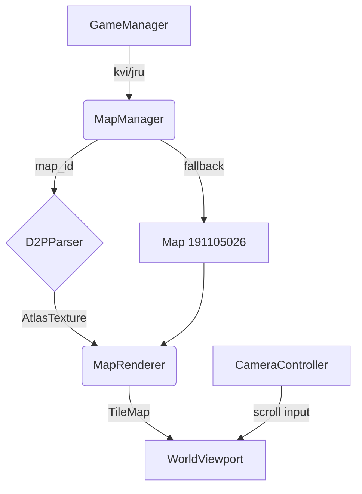

# Plan de Implementación — Spec 003: Visualización de mapa y entorno

**Generado:** 23 Nov 2026  
**Estado:** `clarification.status = PASS` ✅

---

## 🎯 Resumen Ejecutivo

| Métrica | Valor | Límite | Estado |
|---------|-------|--------|--------|
| RF Totales | 6 | - | - |
| RF Críticos | 0 | 3 | ✅ |
| Archivos a generar | 4 | ≤ 500 líneas/archivo | ✅ |
| Dependencias externas | Parser .d2p (GDScript puro) | P-001 | ✅ |

---

## 🧱 Arquitectura Propuesta

```
godot-client/
├── src/
│   ├── Core/
│   │   └── MapManager.gd           # Estado del mapa, fallback ID
│   ├── Network/
│   │   └── D2PParser.gd            # Parser .d2p → AtlasTexture
│   ├── Systems/
│   │   ├── MapRenderer.gd          # TileMap isométrico
│   │   └── CameraController.gd       # Movimiento cámara
│   ├── UI/
│   │   └── WorldViewport.gd         # Contenedor principal
│   └── Data/
│       └── TileCache.gd             # Cache LRU de assets
└── test/
    └── test_map_render.tscn         # Tests de unitarias/visuales
```

---

## 📋 Tareas de Implementación

### Fase 1: Infraestructura de datos ⏱️ 2-3h

| Tarea | Archivo | Estimación | Prioridad |
|-------|---------|------------|-----------|
| T1.1: Crear TileCache.gd (LRU 100MB prototipo) | `src/Data/TileCache.gd` | 45 min | 🔴 Crítica |
| T1.2: Crear D2PParser.gd (header + tiles) | `src/Network/D2PParser.gd` | 1.5h | 🔴 Crítica |
| T1.3: Escribir tests unitarios TileCache | `test/test_tile_cache.gd` | 30 min | 🟡 Alta |

### Fase 2: Sistema de mapa ⏱️ 3-4h

| Tarea | Archivo | Estimación | Prioridad |
|-------|---------|------------|-----------|
| T2.1: Crear MapManager.gd | `src/Core/MapManager.gd` | 30 min | 🔴 Crítica |
| T2.2: Crear MapRenderer.gd (Node2D + TileMap) | `src/Systems/MapRenderer.gd` | 1.5h | 🔴 Crítica |
| T2.3: Implementar isometría CellID→Vector2 | `MapRenderer.gd` | 45 min | 🔴 Crítica |
| T2.4: Cachear tilesets cargados | `MapRenderer.gd` | 30 min | 🟡 Alta |
| T2.5: **Mapa único grid + actualización dinámica** | `MapRenderer.gd` | 45 min | 🔴 Crítica |

### Fase 3: Sistema de cámara ⏱️ 2h

| Tarea | Archivo | Estimación | Prioridad |
|-------|---------|------------|-----------|
| T3.1: Crear CameraController.gd | `src/Systems/CameraController.gd` | 1h | 🔴 Crítica |
| T3.2: Edge-scrolling (5px/0.05s) | `CameraController.gd` | 45 min | 🔴 Crítica |
| T3.3: Smooth zoom/pan | `CameraController.gd` | 15 min | 🟡 Media |

### Fase 4: Integración y UI ⏱️ 2h

| Tarea | Archivo | Estimación | Prioridad |
|-------|---------|------------|-----------|
| T4.1: Crear WorldViewport.gd | `src/UI/WorldViewport.gd` | 30 min | 🔴 Crítica |
| T4.2: Integrar con GameManager | `GameManager.gd` | 45 min | 🔴 Crítica |
| T4.3: Fallback visual gris para assets corruptos | `MapRenderer.gd` | 15 min | 🟢 Baja |
| T4.4: Documentar API pública | `*_gd` | 30 min | 🟢 Baja |

### Fase 5: Testing ⏱️ 1h

| Tarea | Archivo | Estimación | Prioridad |
|-------|---------|------------|-----------|
| T5.1: Test: TileCache LRU eviction | `test/test_tile_cache.gd` | 20 min | 🟡 Alta |
| T5.2: Test: MapRenderer isometría | `test/test_map_renderer.gd` | 20 min | 🟡 Alta |
| T5.3: Test: Camera edge-scroll | `test/test_camera.gd` | 20 min | 🟢 Media |

---

## 🔄 Flujo de Datos



---

## 📊 Estimación de Tiempo

| Fase | Horas estimadas | % del total |
|------|-----------------|-------------|
| Fase 1: Infraestructura | 2.5h | 25% |
| Fase 2: Sistema de mapa | 3h | 30% |
| Fase 3: Cámara | 2h | 20% |
| Fase 4: Integración | 2h | 20% |
| Fase 5: Testing | 1h | 10% |
| **TOTAL** | **10.5h** | **100%** |

**Nota prototipo:** Cache inicial 100MB, expandible posterior a 500MB cuando se integren todos los mapas.

---

## 🔗 Dependencias Técnicas

### APIs que debe consumir

1. **TileSet API de Godot 4.8**
   ```gdscript
   TileSet.new()
   TileSetAtlas source: create_tile_set_atlas_sources()
   ```

2. **CellID → Coordenadas** (de protocolo)
   ```gdscript
   # CellID 12345 → Vector2i (x, y)
   func cell_id_to_coords(cell_id: int) -> Vector2i
   ```

3. **AtlasTexture creation**
   ```gdscript
   AtlasTexture.new()
   atlas_texture.set_atlas(AtlasSource)
   ```

### Mensajes que debe procesar

| Mensaje | Campo clave | Uso |
|---------|-------------|-----|
| `jru` (MapReady) | `mapId`, `cells` | Renderizar mapa |
| `kvi` (Living beings) | `position`, `look` | Posicionar avatar |
| `ivx` (Exchange) | `exchangePositions` | Posición específica |

---

## ✅ Criterios de Finalización

- [ ] T1.1-T1.3 completados y testeados
- [ ] T2.1-T2.4 completados y isometría verificada
- [ ] T3.1-T3.3 completados y scrolling funcional
- [ ] T4.1-T4.4 integrados con GameManager
- [ ] T5.1-T5.3 pasados (unit tests)
- [ ] Mapa `191105026` renderizado con avatar jugador
- [ ] Fallback 30s funcional
- [ ] Parser `.d2p` generando AtlasTextures válidos

---

## 🚨 Riesgos Identificados

| Riesgo | Impacto | Mitigation |
|--------|---------|------------|
| Parser .d2p complejo | Bloquea todo | Investigar formato header primero |
| TileMap isométrico | Rendering lento | Usar `TileMap` con `Mode = ISOMETRIC` |
| Cache saturada | OOM | LRU estricto, ajustable 100-500MB según prototipo |
| Timer race condition | Duplicado render | Priorizar `jru` válido sobre timer |

---

## 📝 Notas Técnicas

1. **Parser .d2p:** El archivo `.d2p` contiene múltiples recursos (tiles, sprites). El header define offsets. Se recomienda leer el specification de Ankama D2P format v3.6.x.

2. **Isometría en Godot:** Usar `TileMap` con `mode = TileMap.TILE_MODE_ISOMETRIC` y ajustes de `cell_size = Vector2i(32, 16)`.

3. **CellID → Coordenadas:** Fórmula del protocolo:
   ```
   cell_x = cell_id % map_width
   cell_y = cell_id / map_width (integer division)
   ```

4. **Assets:** Los `.d2p` de `d3maps` contienen tilesets. Los de `d3gfx_2x` contienen sprites NPCs/characters.

5. **Nota prototipo:** Cache inicial 100MB, expandible posterior a 500MB cuando se integren todos los mapas del juego. Enfoque: solo 10-15 mapas continuos (como los de Astrub) para evitar consumo excesivo de memoria.

### Ruta de assets:
- `.d2p` files: `C:/Users/pevalcar/AppData/Local/Alea/d3maps/`
- Map Index: `C:/Users/pevalcar/AppData/Local/Alea/d3maps/map-index.json`
- Mapa fallback: `191105026` (Astrub zaap)

### Cache de prototipo:
- Solo 10-15 mapas continuos (como los mapas de Astrub)
- 100MB inicial, expandable a 500MB
- Evita consumo excesivo de memoria

---

## 🎯 Enfoque Arquitectónico - Mapa Único Grid Isométrico

El mapa es un **único grid isométrico** donde:
- Las coordenadas representan información de transitable/no transitable
- La visualización (suelo, agua, muro) se actualiza dinámicamente
- Un solo TileMap para todo el mundo (no múltiples mapas)

### Características clave:
- Coordenadas (x, y) son el estado de la celda
- Tile ID actualizado dinámicamente según cambios del juego
- Soporte para capas: suelo, objetos, decoración
- Actualización en tiempo real de transitable/bloqueado

---

## 📚 Referencias

- Spec 003: `specs/003-map-world-entry/spec.md`
- Clarify Report: `specs/003-map-world-entry/clarify-report.md`
- Protocol docs: `godot-client/docs/PROTOCOL.md`
- CellID reference: `docs/CellID_REFERENCE.md` (si existe)